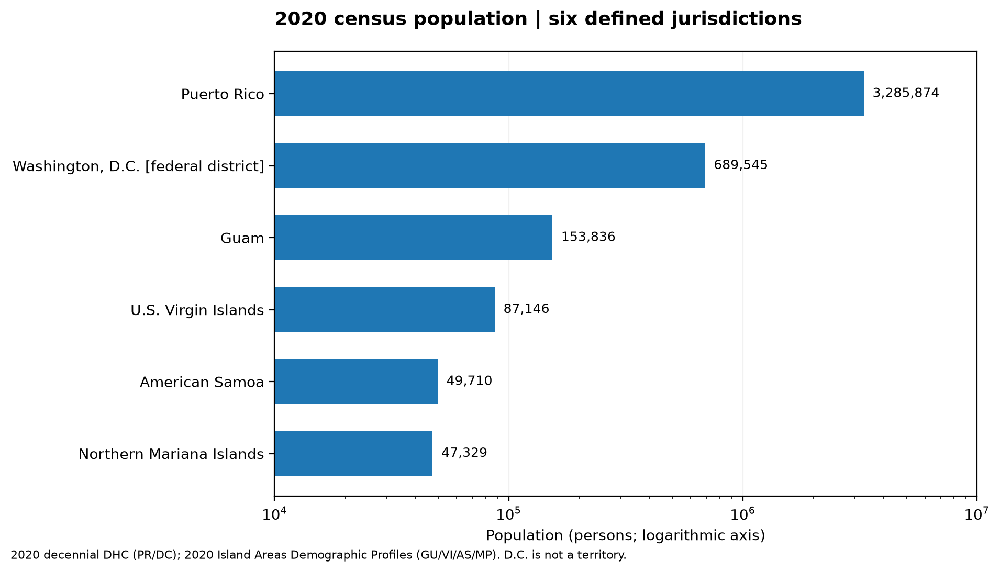
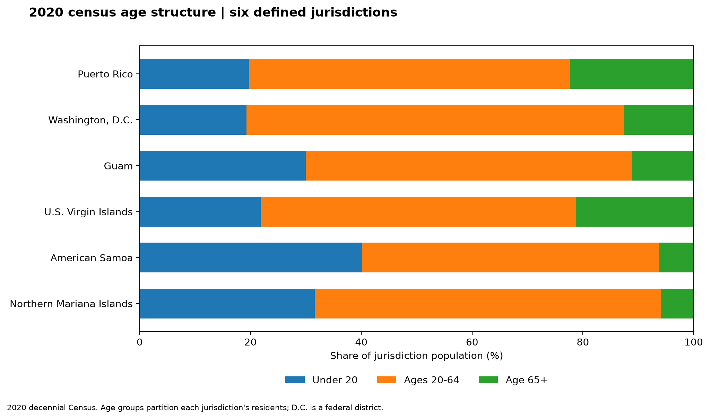
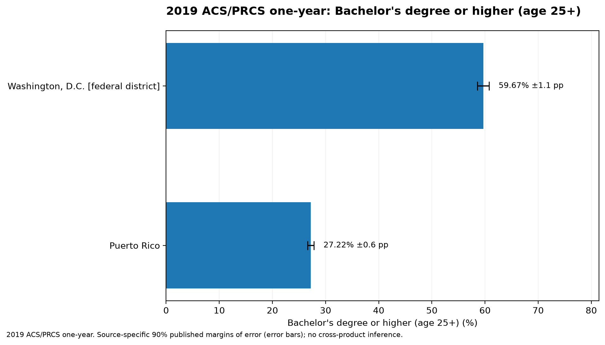

# Start Here — Independent Faculty Research Review

**Territorial Representation Research | Prepared for an independent statistical/methodological reviewer**

**Review status:** Invitation reported sent by research owner; reviewer agreement, comments, and institutional endorsement have **not** been received or verified. This is a *working research manuscript*, not a faculty-approved paper, final committee policy, or peer-reviewed publication.

## Purpose of the project

This project documents demographic and source-specific socioeconomic evidence for the **five inhabited U.S. territories** (Puerto Rico, Guam, American Samoa, U.S. Virgin Islands, Northern Mariana Islands) and **Washington, D.C.**, which is a **federal district, not a territory**.

The primary demographic analysis covers the six defined jurisdictions' **2020 Census population of 4,313,440** residents. Socioeconomic evidence comes from three *distinct* Census product families. It is not presented as a uniform or pooled six-jurisdiction statistical sample.

## Read these materials first

1. **[Research manuscript: complete academic working draft](08_Final_Report/Phase2MD_Integrated_Academic_Manuscript_Review_Draft.md)** — Abstract, purpose, research design, methods, five evidence tables, 90% margins of error, discussion, limitations, and provisional citations.
2. **[Research figures: 14 data-validated charts](05_Statistical_Graphics/Phase2ME/)** — 2020 population and age structure, four Island Areas Census plots, four 2019 ACS/PRCS charts, and four 2016–2020 ACS/PRCS charts. Both PNG and SVG versions are available.
3. **[Consolidated research readiness and methodological decision](09_Committee_Package/Phase2MF_Consolidated_Academic_Readiness_Decision.md)** — One location for the research scope, evidence acceptance, technical limitations, outstanding questions, and GO/NO-GO controls.
4. **[Faculty review handoff questions](09_Committee_Package/Phase2K_Faculty_Review_Handoff.md)** — Specific questions regarding uncertainty, source comparability, Census source definitions, and acceptable conclusions.
5. **[Independent faculty review decision form](09_Committee_Package/Phase2K_Faculty_Review_Decision_Form.md)** — Optional structured rubric; no reviewer signature or approval has been entered.

## Example figures

### Figure 1 — 2020 census population of the six defined jurisdictions



### Figure 2 — 2020 age composition by jurisdiction



### Figure 3 — 2019 one-year ACS/PRCS bachelor's-degree attainment with 90% margins of error



These figures are shown as **illustrations of the archived evidence**. The Island Areas Census and ACS/PRCS survey results have different sources, reference periods, population universes, and uncertainties. They must not be treated as a single harmonized six-case socioeconomic comparison.

## What can be independently reproduced?

**Core evidence verification** works on Windows and GitHub Linux, uses Python's standard library, and does not change the original datasets:

```sh
python 06_Methodology/Phase2/validate_phase2m_portable.py
```

**Manuscript and figure checks**:

```sh
python 06_Methodology/Phase2/validate_phase2md_academic_manuscript.py
python 06_Methodology/Phase2/validate_phase2me_figures.py
```

For archived source hashes and method details see [the data provenance record](DATA_PROVENANCE.md), [the Census MOE investigation](06_Methodology/Phase2/PHASE2I_DC_EDUCATION_MOE_ROOT_CAUSE_REVIEW.md), and [the graphics evidence index](05_Statistical_Graphics/Phase2ME/FIGURE_INDEX.csv).

## The questions where independent faculty input is most valuable

- Are the five inhabited territories and D.C. appropriately classified and scoped?
- Are the three Census data products and their distinct statistical universes clearly explained?
- Are the published **90% Census margins of error** and D.C. education composite-count MOE reconciliation appropriately interpreted?
- Are the statistical and political inference limits adequate?
- Are the provisional APA 7 citations complete, with correct title metadata and author-year suffixes?
- Is the documented historical SPSS `.sav` byte-hash exception adequately disclosed?

The current `.sav` is byte-identical with its Git archive and its contents were validated against the canonical CSV, but the cause of a difference from an earlier recorded SHA-256 is **unresolved**.

**Requested outcome:** An independently attributable written methods review, identifying necessary revisions or a qualified PASS / CONDITIONAL / REVISE / NO-GO disposition. A review does not imply automatic endorsement by Pittsburg State University or the Kansas Green Party.

**Privacy:** Please respond privately using the original student-email correspondence, rather than posting signatures, grades, student information, or private comments in this public repository.
